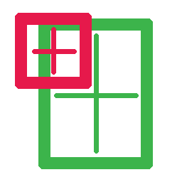
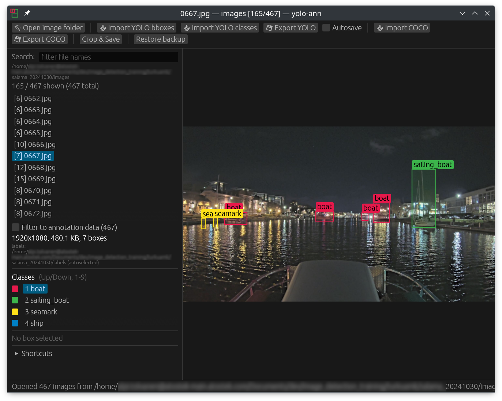

# yolo-ann-rs 

A local Rust/egui recreation of the web tool <https://lddl.github.io/yolo-ann/> for drawing YOLO/COCO bounding boxes.



Main features
* YOLO and COCO import/export
* Simple and fast, with hotkeys
* Handles large amount of images (unlike the web tool)

More
- Images are read lazily from disk, thus folders with thousands of images open instantly.
- The next 6 and previous 2 images are decoded in background threads, so switching images is instant.
- Annotations are backed up to a local file automatically, so nothing is lost on a crash, kill or power-off.
- YOLO txt labels are read and written directly. COCO json import and export are supported.

This application is fully vibe-coded with claude opus 5.5.

## Download

Prebuilt binaries for Linux (x86_64, aarch64), macOS (Apple Silicon, Intel) and Windows (x86_64) are on the [Releases](https://github.com/alpitol/yolo-ann-rs/releases) page. Download the one for your system and run it; there is nothing to install.

- **Windows**: `yolo-ann-<version>-x86_64-windows.exe`. Double-click it. The exe is not signed, so SmartScreen may warn; choose *More info* → *Run anyway*.
- **Linux**: needs glibc 2.35 or newer (Ubuntu 22.04+) and an X11 or Wayland desktop with OpenGL. Make the file executable first: `chmod +x yolo-ann-*-linux`.
- **macOS**: the binary is not signed, so make it executable and remove the quarantine flag once before running: `chmod +x yolo-ann-*-macos && xattr -d com.apple.quarantine yolo-ann-*-macos`.

## Build & run

To build and run the program
```sh
cargo run --release
```

| Option | Meaning |
|---|---|
| `-l, --labels DIR` | Import YOLO labels from this folder (also the save target). Default: the image folder, if it contains label files, else the YOLO layout's `labels` folder: the image folder path with its last `images` component replaced by `labels` (`ds/images/train` → `ds/labels/train`), if it exists. Shown as *autoselected* |
| `-c, --classes FILE` | Class names: one per line, `<id> <name>` per line (a `metadata.txt`, see below), or an Ultralytics `data.yaml` (`names` as a list or an `{index: name}` map). Auto-detected: `classes.txt`, `obj.names`, `metadata.txt`, `*.names`, `data.yaml`, `dataset.yaml` in the image folder or the imported labels folder, or in their parent if the folder is named `images` or `labels`. Opening another folder never keeps the previous folder's classes. On restart, the class file of the reopened last folder is reloaded |
| `--coco FILE` | Import a COCO json on startup. Its categories, sorted by id, replace the class list (see **Import COCO**) |
| `--ahead N` / `--behind N` | Prefetch window (default 6 / 2) |
| `--workers N` | Decoder threads |
| `--autosave true` | Write the label file automatically when leaving an image |
| `--license` | Print the license of yolo-ann and of the third-party software it includes |

## Hotkeys

| Key | Action |
|---|---|
| ← / → (A / D) | previous / next image (wraps) |
| ↑ / ↓ (W / S) | previous / next class (wraps); with a box selected, changes that box's class instead |
| 1–9 | select class |
| Delete / Backspace / X | remove selected box |
| Shift+Delete | delete the current image file and its label file from disk (asks first) |
| Left drag | draw box (Shift: always draw, even on top of a box) |
| Left click | select box; click again to cycle overlapping boxes |
| Drag selected box | move; drag its edges or corners to resize |
| Mouse wheel | zoom at cursor |
| Middle / right drag | pan |
| F / Home | reset zoom |
| F11 | toggle full screen (hides the window title bar) |
| Esc | deselect / cancel drag |
| Ctrl+Z, Ctrl+Y / Ctrl+Shift+Z | undo / redo (per image) |
| Ctrl+C | copy the current image file to the clipboard, as a file manager does, so it can be pasted into a file manager, chat or upload dialog |
| Ctrl+S | update the YOLO labels folder |
| Ctrl+O | open image folder |

In the image list, `*N` marks an image whose boxes were edited since the last import/export (N boxes). `[N]` marks a visited image with N boxes. Right-click an image for **Copy file name** and **Delete file…**, which after confirmation permanently deletes the image file and its label file in the labels folder, and drops the image's annotation data.

## Saving & backup

Labels come only from what you import, from `.txt` files next to the images, or from the YOLO layout's sibling `labels` folder (see `--labels`).

**Annotation data.** An image has annotation data, possibly an empty box list, if it was imported from YOLO or COCO, restored from a backup, edited, or left with the arrow keys or a list click after being shown. Opening a folder or jumping because of a filter does not count. Exports include exactly these images. **Filter to annotation data**, below the image list, shows only them, which is useful for inspecting and editing a subset inside a folder that holds the whole dataset. If you visited an image by accident, right-click it in the list and choose **Untrack empty image**. This removes its empty data and deletes its label file if that file is empty. The option is available only for images that have no boxes and have not had boxes removed since the last import or export.

- **Class ids.** With a plain class list the class id in the label files is the line index. A class file with `<id> <name>` lines, such as a `metadata.txt` next to `images/` and `labels/`:
  ```
  1 motor_boat
  2 sailing_boat
  3 ship
  ```
  gives each class its id explicitly (here 1-based). Label files are read and written with those ids, so the dataset keeps its numbering. Ids not listed are kept unchanged. Loading such a file after the labels were already read keeps the ids the boxes had in their label files. Exports to a folder without a class file get a `metadata.txt` instead of `classes.txt`. COCO export still uses category id = class index + 1.
- **Import YOLO bboxes** loads `<stem>.txt` files from a folder. The first imported folder becomes the *labels folder*. Folders imported on top of it are unsaved edits.
- **Export YOLO** has two modes:
  - *Update labels folder* (Ctrl+S) writes only the changed files.
  - *Export to another folder* writes every image with data to a new or existing folder, which then becomes the labels folder.

  Ctrl+S without a labels folder asks for one. `classes.txt` is added if the folder has none. Writes are atomic.
- **Opening a folder** starts from scratch: boxes, classes and the labels folder come only from that folder (or the command line). **Import COCO** likewise replaces all annotation data with the file's images and boxes, and the class list with its categories sorted by id. It also unsets the labels folder, so the next Ctrl+S asks where to write. Both ask first if some images have unsaved edits. Only `bbox` is read; `segmentation` (polygon or RLE) and `iscrowd` are ignored. **Export COCO** writes standard COCO detection json (`info`, `licenses`, `categories`, `images`, `annotations`) with one image or annotation per line. Category id = class + 1, and coordinates are pixels rounded to 0.01. Images with empty annotation data are included as background images. The default file name is `<folder>_HUMAN_FIXED.json`.
- **Crop & Save** writes one crop per box to a chosen folder.
- **Automatic backup:** all unsaved annotations are written about 2 s after every change, and on every image switch and on exit, to
  `~/.local/share/yolo-ann/backups/<folder>-<hash>.json` (one file per image folder). The previous session's file is kept as `*.prev.json`.
  When a folder whose backup contains unsaved annotations is opened, a banner offers **Restore / Ignore / Delete backup**. **Restore backup** loads any backup file manually.
- Settings are stored in `~/.config/yolo-ann/settings.json`: the last image folder and image, and the last folder used by each file dialog. The dialogs remember YOLO labels, YOLO classes, COCO json and crops separately.
- Closing the window asks whether to save first only if some image's boxes actually differ from what was last imported or exported (YOLO or COCO). Just browsing or importing never triggers it, and undoing an edit clears it. The backup holds exactly those edited images.

## Tests

```sh
cargo test                     # unit tests and headless UI tests (egui_kittest)
YOLO_ANN_BENCH_DIR=dir cargo test --release decode_speed -- --ignored --nocapture
```

`YOLO_ANN_HOME=dir` redirects the backup and settings directories, which the tests use.
